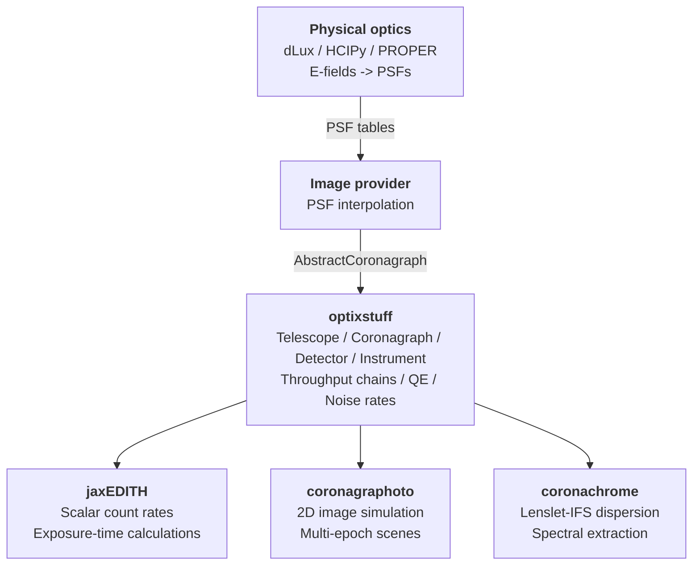

# optixstuff

<p align="center">
  <a href="https://pypi.org/project/optixstuff/"></a>
  <a href="https://optixstuff.readthedocs.io"></a>
  <a href="https://github.com/CoreySpohn/optixstuff/actions/workflows/ci.yml"></a>
  <a href="https://github.com/CoreySpohn/optixstuff/blob/main/LICENSE"></a>
  <a href="https://github.com/CoreySpohn/optixstuff/blob/main/pyproject.toml"></a>
  <a href="https://doi.org/10.5281/zenodo.20819379"></a>
</p>

Shared hardware objects - with standard values - for the HWO direct-imaging
simulation suite.

## What optixstuff is

`optixstuff` is a **thin shared dependency** that defines the observatory's
hardware as composable JAX modules: primary aperture, throughput-affecting
elements, coronagraph backend, detector. Its job is to be the single source of
truth for the hardware configuration that downstream tools consume.

[coronagraphoto](https://github.com/CoreySpohn/coronagraphoto)
(2D image simulation), [coronachrome](https://github.com/CoreySpohn/coronachrome)
(lenslet-IFS dispersion + spectral extraction), and
[jaxEDITH](https://github.com/CoreySpohn/jaxedith)
(exposure-time and yield calculations) import the same `Instrument` class and
the same detector / throughput / primary / disperser types from optixstuff.
Change a value here and every downstream tool picks it up on the next import.

## What optixstuff is *not*

- **Not a wavefront tool.** Diffraction, E-field propagation, and PSFs-from-first-principles
  belong to [dLux](https://github.com/LouisDesdoigts/dLux) and [HCIPy](https://github.com/ehpor/hcipy).
- **Not a PSF interpolator.** Image providers implement the shared
  `AbstractCoronagraph` contract; optixstuff owns the contract and scalar models.
- **Not a scene model.** Stars, planets, disks, and zodi live in
  [skyscapes](https://github.com/CoreySpohn/skyscapes).
- **Not a simulator.** Downstream tools (coronagraphoto, coronachrome, jaxEDITH)
  consume an `Instrument` to produce images, dispersed IFS frames, or count rates.

## Architecture

Built on [JAX](https://github.com/google/jax) and
[Equinox](https://github.com/patrick-kidger/equinox), `optixstuff` provides:

- **Abstract interfaces** - `AbstractPrimary`, `AbstractOpticalElement`,
  `AbstractCoronagraph`, `AbstractDetector`, `AbstractDisperser`
- **Concrete implementations** - `SimplePrimary`, `SegmentedPrimary` (carries
  hex segment geometry for a diffraction backend), `ConstantThroughput`,
  `IdealDetector`, `Detector` (with optional wavelength-dependent QE),
  `LensletDisperser`
- **Container** - `Instrument`, a composable hardware configuration passed to all
  simulators

Optical elements and coronagraphs accept fidelity axes - **wavelength**, **position**, and
**time** - with defaults so that simple implementations can ignore unused axes while
future high-fidelity models (wavelength-dependent coatings, position-dependent vignetting,
time-dependent detector degradation) can use them without breaking the interface.

### Primary geometry and coronagraph grids

Primaries expose `diameter("circumscribed")`, `diameter("inscribed")`, and
`collecting_area_m2`. Build a lambda/D frame with `primary.frame(500.0)`.
`SimplePrimary` takes both diameters and collecting area as keyword arguments;
`SegmentedPrimary` derives them from segment size, gap, and ring count.

Coronagraph images use `optixstuff.grids.Image` and an explicit target `PixelGrid`.
Coordinates are `(x, y)`, arrays are `(..., y, x)`, and even-grid centres fall
between pixels. For example, `band.off_axis_psf(500.0, 3.0, target)` returns
per-pixel fractions of unocculted source flux. Use `.data` to obtain its array.
Select the imaging model with `band = coro.band(500.0)`. Its
`at_wavelength(500.0)` gives the source, stellar and uniform-sky grids.
Scene models return an image and a validity flag from
`render_scene(scene_image, 500.0, grid=target)`.

`coro.curves(Circular(0.7))` is the single performance record for that aperture.
Import `Circular` from `optixstuff`; prepare every required rule before JIT
when constructing an image provider.
Records contain throughput, core area, stellar leakage fraction, leakage density,
raw contrast, `iwa_lod`, and `data_extent_lod`. A known design limit is separately
named `outer_working_angle_lod`. `ScalarCoronagraph` stores calibrated constants
for one declared aperture.
`MultiBandCoronagraph` selects the first declared bandpass covering the wavelength.
Coronagraph and speckle timestamps use `time_d`, days from the scene epoch;
exposure durations remain seconds.

### Linear speckle fields

Subclass `LinearSpeckleField` and implement `coefficients(time_d)`, subtracting
its static host `epoch_d` internally. Construct a `FocalResponse` with the
complex nominal amplitude density `e_nom`, sensitivity density `G`, native
`lod` grid, unocculted input energy and reference wavelength. The shared law
uses `response.per_pixel()` and returns the excess
`[2 Re(conj(e_nom) G eps) + |G eps|^2] / input_energy`, with `G` scaled by
`reference_wavelength_nm / wavelength_nm`.

`realize(wavelength_nm=..., time_d=...)` returns an `Image` on the field's own
grid, with `Measure.integral()`, `stellar_flux_fraction`, `band_limited`, and `reflect`
metadata. Wavelength arrays, including quadrature nodes `(W, Q)`, become leading
axes. Each native lambda/D coordinate uses the node wavelength: convert with
`image.grid.to_arcsec(node_nm)` before resampling that node onto a detector.

`broadened(quadrature=..., time_d=...)` averages realized nodes at fixed native
lambda/D coordinates, normalizing the nm weights to sum to one per band.
Detector-band images instead require resampling and spectral weighting at each
node before integration. `realize_average(..., exposure_s=..., start_time_d=...)`
retains its midpoint time-average meaning. Enable JAX x64 for deep contrast and
for adding small offsets to absolute day timestamps. Nonlinear replay models
continue to implement `AbstractSpeckleField` directly.

### Detector chain

Readers supply `PhotonRates` in photons/s/nm at shared quadrature nodes.
The detector converts them to `ElectronRates` with spectral QE and survival
applied once, before integration. The observer owns the frame plan.

```python
import jax
import jax.numpy as jnp
from optixstuff.spectral import Band, Quadrature
from optixstuff import Detector, PhotonRates, frames_for_time

detector = Detector(pixel_scale_arcsec=0.01, shape=(1, 1), qe=0.9)
quadrature = Quadrature.build([Band(500.0, 600.0)], detector, order=3)
rates = PhotonRates(quadrature, planet=jnp.ones((1, 3)))
electrons = detector.electrons(rates)
plan = frames_for_time(time_s=600.0, frame_time_s=300.0)
mean, variance = detector.mean_and_variance(electrons, plan)
counts = detector.draw(jax.random.key(0), electrons, plan)
```

The six source fields retain their names throughout the chain. Image readers
use `(W, Q, ny, nx)` integrands; aperture readers use `(W, Q)`. The detector
returns `(W, *spatial)` electrons/s and count moments. See the
[detector contract](https://optixstuff.readthedocs.io/en/latest/explanation/detector_models.html)
for noise parameters, gain statistics, and readout overlap.

### Ecosystem position



## Installation

```bash
pip install optixstuff
```

## Status

This package is in early development (pre-v0.1.0).
