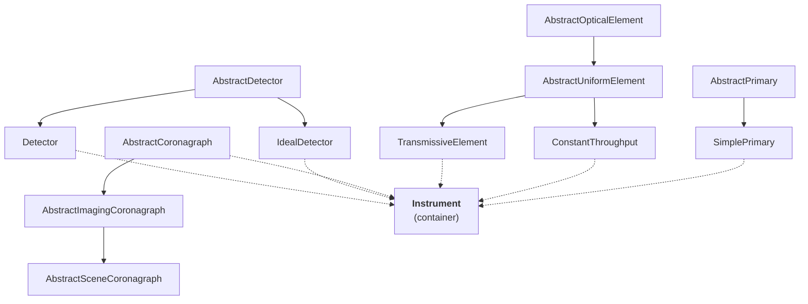

# Architecture

optixstuff is the thin shared hardware dependency for the HWO
simulation suite. This page covers the hardware objects it
provides and the three-axis design (wavelength / position / time).

## The role of optixstuff

`optixstuff` provides **composable hardware objects** (primary,
throughput elements, coronagraph backend, detector) and a container
(`Instrument`) that bundles them. The hardware objects hold attributes
like quantum efficiency curves, throughput, dark-current
rates, and pixel scales; downstream tools query those attributes to
do their own work.

It (generally) does **not** simulate. There is no "simulate this observation"
entry point in optixstuff. Instead:

1. **Analytic aperture rates** (jaxEDITH) ask "given this hardware,
   these performance curves and this target, what's the per-aperture
   count rate?" The hardware attributes are inputs.
2. **2D image simulation** (coronagraphoto) asks "given this hardware
   and this scene, what does the detector see?" The same hardware
   attributes are inputs.

Both tools need the same hardware definition. optixstuff is the shared
source of truth: change the detector's QE here and both your ETC
numbers and your simulated images update together on the next import.

## The abstractions



Five families of abstract base + concrete implementations, composed
into a single `Instrument`:

| Family | Abstract base | Concrete examples |
|---|---|---|
| Primary aperture | `AbstractPrimary` | `SimplePrimary` |
| Throughput-affecting element | `AbstractOpticalElement` | `ConstantThroughput`, `TransmissiveElement` |
| Coronagraph backend | `AbstractCoronagraph` | `AbstractTableCoronagraph` providers, `MultiBandCoronagraph` |
| Detector | `AbstractDetector` | `IdealDetector`, `Detector` |
| Composition container | (none) | `Instrument` |

## What throughput elements stand in for

`ConstantThroughput` and `TransmissiveElement` represent optical losses.
Tabulated responses use `optixstuff.spectral.Transmission`,
which interpolates linearly and is zero outside its table. `Transmission.from_band`
represents a unit bandpass; constant optical losses use a scalar
`ConstantThroughput`. Mapping to real hardware:

| Concrete element | Represents |
|---|---|
| `ConstantThroughput` | Flat-reflectivity mirror coating, broadband neutral-density filter, fold mirror with achromatic reflectivity |
| `TransmissiveElement` | An element holding a `Transmission`: mirror reflectivity curves, bandpass filters, dichroics, other filters |

A real instrument has many individual physical components (primary
mirror, secondary, deformable mirror, fold mirrors, polarisers,
bandpass filters, dichroics, lenses), each with its own throughput
curve. In optixstuff they all enter the radiometric model the same
way: "a wavelength-dependent fraction that scales the incoming flux."
The `Instrument` holds a `tuple[AbstractOpticalElement, ...]` whose
effective throughput is the product of every element's
`get_throughput(wavelength_nm)`:

This example requires measured throughput curves and a configured coronagraph and detector.

```python notest
from optixstuff.spectral import Transmission

path = Instrument(
    primary=SimplePrimary(circumscribed_diameter_m=6.0, collecting_area_m2=28.0),
    attenuating_elements=(
        ConstantThroughput(throughput=0.95),  # primary coating
        ConstantThroughput(throughput=0.95),  # secondary mirror
        ConstantThroughput(throughput=0.97),  # fold mirror
        TransmissiveElement(
            Transmission(wavelengths_nm, mirror_R)
        ),  # measured mirror reflectivity
        TransmissiveElement(Transmission(wavelengths_nm, filter_T)),  # bandpass filter
    ),
    coronagraph=...,
    detector=...,
)

print(path.system_throughput(550.0))  # product across all elements
```

The abstraction lets you swap real-instrument throughput curves in
and out without changing how downstream tools consume the result.
Higher-fidelity elements (e.g. one with a position-varying vignetting
profile) can subclass `AbstractOpticalElement` directly to use the
position axis, as the next section describes.

## The three-axis design

Optical elements and coronagraphs expose wavelength, position, and time
where those axes affect their response. Detectors expose
`quantum_efficiency(wavelength_nm)` for spectral yield. All detector
subclasses share the same `electrons`, `mean_and_variance`, and `draw`
contract. `IdealDetector` supplies QE one; `Detector` supplies constant
or measured spectral QE. Frame duration belongs to `FramePlan`.

## Instrument as a composable container

`Instrument` is an `eqx.Module` (PyTree-registered) that holds the
hardware configuration:

```python
import equinox as eqx
from jaxtyping import Array
from optixstuff import (
    AbstractDisperser,
    AbstractSpeckleField,
    AbstractPrimary,
    AbstractOpticalElement,
    AbstractCoronagraph,
    AbstractDetector,
)


class Instrument(eqx.Module):
    primary: AbstractPrimary
    attenuating_elements: tuple[AbstractOpticalElement, ...]
    coronagraph: AbstractCoronagraph | None
    detector: AbstractDetector
    disperser: AbstractDisperser | None = None
    speckle: AbstractSpeckleField | None = None
    flux_scale: Array = 1.0  # dimensionless flux calibration
```

The disperser and speckle slots are optional: a disperser marks an IFS
configuration and a speckle field adds time-varying leakage on top of the
coronagraph's deterministic floor. The container exposes four quantities used
by the readers.

- `system_throughput(wavelength_nm)`: product of all element
  throughputs at a wavelength
- `effective_area_m2(wavelength_nm)`: collecting area times that
  throughput times `flux_scale`, the one place the three are combined; a
  simulator multiplies a source's photon flux density by it. `flux_scale` is
  the dimensionless absolute flux calibration, one by default, linear in every
  rate
- `detector.quantum_efficiency(wavelength_nm)`: detector QE at that wavelength
- `spectral_breaks_nm()`: union of the element, coronagraph, detector, disperser
  and speckle breaks for host quadrature construction

That's it. The container does not own simulation logic; it just holds
hardware. Simulators (coronagraphoto, jaxEDITH) consume the container,
query its throughput and QE, and produce rates. `snr` and `exposure_time`
reduce those rates to science-level outputs. [How an exposure time is
computed](exposure_time.md) follows both producers to that reduction.

## PSFlet template packs

`LensletDisperser.psflet_pack_path` points to a version 2 `.npz` file. At each
field anchor and wavelength, the template is centered on the PSFlet centroid.
The optional `centroids` entry gives the `(dx, dy)` offset in detector pixels
from the dispersion-model centroid to that template origin. If a tilt
displaces a PSFlet by 0.3 pixel in positive x, its `centroids` entry is
`(0.3, 0)` and its template is centered on zero. Regenerate version 1 packs
before loading them with `load_psflet_pack`. Offset coordinates must form a
finite, strictly ascending, uniform axis both on input and after rounding to
float32. This lets either precision lane write a pack that both lanes can read.

External writers must declare `template_origin = "centroid"` as a string in
the format 2 archive. `load_psflet_pack` refuses packs from earlier format 2
writers that omitted this field. Regenerate those packs before loading.

## Exposure pointing

An `Exposure` holds `Pointing(roll_deg, offset_mas=None)` alongside its
observation time, wavelength quadrature, and optional frame plan. Construct an
exposure with `pointing=Pointing(roll_deg)` for an on-axis target. The roll and
any supplied offset are floating-point leaves, so a fit can address them at
`exposure.pointing.roll_deg` and `exposure.pointing.offset_mas`.

See [pointing and detector coordinates](grids_and_spectra.md#pointing-and-detector-coordinates)
for the frame, sign, and units of the offset.

## Photon rates, electrons, and detector noise

Scene readers supply photon `Rates` at `optixstuff.spectral.Quadrature` nodes.
`detector.electrons(rates)` applies survival and QE at each
node, then integrates into electron `Rates`. This is the only detector
yield conversion. Optical throughput remains upstream of that boundary.

The observer chooses a frame duration and calls
`frames_for_time(time_s, frame_time_s)` to obtain a `FramePlan`.
`detector.mean_and_variance(electrons, plan)` computes the electron budget;
`detector.draw(key, electrons, plan)` samples that budget with per-pixel
Poisson counts, optional excess gain noise, and Gaussian read noise.
Combine sources before drawing so detector noise is counted once.

See [detector models](detector_models) for units, shapes, timing, and the
explicit excess-noise distribution.

## S/N and exposure time

`snr(rates, detector, time_s, frame_time_s=..., post_processing=...)` and
`exposure_time(rates, detector, target_snr, ...)`, which take `frame_time_s` and
`post_processing` as required keywords, reduce one aperture's `Rates`
to S/N or to the continuous live time that reaches a target. They read
`detector.mean_and_variance`, so the analytic reduction and a drawn image share
one statistical model. With planet electrons `p`, the detector variance of one
frame per live second `b` and the squared residual rate `f2`,
`S/N = p t / sqrt(b t + f2 t**2)` and `t = snr**2 b / (p**2 - snr**2 f2)`.

`PostProcessing` holds the assumptions of the subtraction. The two residual
fractions in [0, 1] set `f2` from the star-leakage and exozodi rates, and
`background_variance_factor` `m >= 1` multiplies the variance of every source
except the planet's own shot noise. It has no default, and neither calculator accepts a
missing `PostProcessing`: the caller states whether a reference image is subtracted. `m = 2` is differential imaging, the
reference image carrying the same background variance as the science image;
the AYO and pyEDITH convention is
`PostProcessing(1 / ppf, 1 / ez_ppf, background_variance_factor=2.0)`. `m = 1`
counts each background once, with no reference subtraction. An
unreachable target has `valid` False and a time of NaN; round a reachable
time with `frames_for_time`.

## Aperture frames, images, and performance records

A primary stores collecting area independently of its two diameter conventions.
`primary.frame(reference_wavelength_nm, convention="circumscribed")` creates a
shared `Frame` without asking the consumer to repeat a diameter conversion.
For segmented apertures the inscribed circle follows the scalloped outer outline,
bridging perimeter gaps; the internal segment gaps reduce collecting area only
through the declared segment sizes, and do not define the aperture diameter.

Select the model for a wavelength with `coronagraph_at(wavelength_nm)`. An imaging model's
`at_wavelength(wavelength_nm)` returns its `source_grid`, `stellar_grid` and
`sky_grid`. Source offsets and stellar diameters use their respective native
frames. The target grid defines the output units, frame and pixel centres.

`source_psfs` returns an image and a validity flag for each source.
`stellar_map` returns the finite-star image, and `uniform_sky_map` describes
extended illumination.
A scene-capable band provides `render_scene(scene, wavelength_nm, grid=target)`.
The result includes a validity flag covering every illuminated position.

| Product | Image measure | Image quantity |
|---|---|---|
| PSFs and stellar maps on a requested grid | `Measure.integral()` | `stellar_flux_fraction` |
| Uniform-sky map | `Measure.intensive()` | `transmission` |
| Extended scene | `Measure.integral()` | Input scene quantity |

Transmission is dimensionless. A native PSF table retains the sampling declared
by its producer. A requested grid receives the fraction of unocculted source
flux collected by each pixel.

`PerformanceCurves` is the coronagraph characterization: a record of profiles
on one lambda/D axis for one aperture rule, built by `performance_curves`.
No simulation reads it from the coronagraph slot; a provider that stores records
hands them out as data, and `record.evaluate(name, separation_lod)` is the one
read; the leakage fields and `raw_contrast` also take `stellar_diameter_lod` (see
below). `leakage_density_lod2` is already per square lambda/D; no pixel-area
correction belongs in consumers. Post-processing may divide that density, or raw
contrast, by `ppf`; `optixstuff.PostProcessing.speckle_residual_fraction` owns the
residual. No noise floor is a coronagraph property.
For table images, `stellar_map(..., grid=None)` and `source_psfs(..., grid=None)`
return native samples and product metadata. An explicit grid requests pixel
integration, including at native pitch.
The record's contrast identity holds at measured knots; `PerformanceCurves`
interpolates the five fields in their declared spaces independently between knots.
The leakage fields and `raw_contrast` carry one profile per stellar diameter of
the product (`stellar_diameters_lod`, in the record's lambda/D, shape `(K, S)`),
so a star's size is part of the read: `evaluate` interpolates the log profile
between diameters with a cubic spline on the measured diameter axis. Range
checks, knot matches, and interval selection use float32 coordinate resolution
in both lanes. The measured diameters must remain distinct on that grid.
A query matching a knot uses that row and its separation slope. Between knots
the polynomial uses the query at working precision.

The shipped product tabulates 12 stellar diameters, from 0 and 0.001 to
1.0 lambda/D, doubling the diameter between positive knots. In the diameter
benchmark, the curves route agreed with the image route to 0.14 percent at
0.045, 0.5 percent at 0.09, 3.8 percent at 0.18, 10 percent at 0.36 and
19 percent at 0.71 lambda/D, for separations of 2.9 to 11 lambda/D. The maps
supply values at the knots, so the larger between-knot residuals limit the
comparison. A Sun at 10 pc is 0.032 lambda/D at 1 micron. A diameter beyond
the last knot raises. At the tabulated diameters the record agrees with the
ring mean of that plane to 0.14 percent up to 0.126 lambda/D and 0.6 percent
from 0.25 lambda/D. A record prepared from one stellar image holds one profile
and serves only a star of that diameter.

`bandpass` is a `optixstuff.spectral.Band` or `None` for unknown coverage;
each child of a multiband model must declare its interval. The first child
covering the requested wavelength supplies the model, including at a shared
edge. Dispatch rounds both coordinates to the float32 wavelength grid before
applying the wavelength merge rule (strictly less than four spacings, with a
1e-9 nm floor). For a single-wavelength product, band dispatch uses the mean
of the two rounded observing-band edges. For a band-averaged product whose
original edges satisfy the merge rule, no positive-width tile fits. A point
observation is allowed, as is an explicit wide-band override.

## Speckle excess

`AbstractSpeckleField` owns a native `lod` `grid` with its `Frame` and an
`epoch_d` clock origin. It remains the interface for nonlinear implementations,
including replayed intensity cubes. `LinearSpeckleField` supplies the common
law for coefficient-driven fields; subclasses implement
`coefficients(*, elapsed_s)` and never read `epoch_d`. A field runs on its own
clock: every method takes `elapsed_s`, seconds since the field's clock origin.
`epoch_d` places that origin on the scene clock, in days from the scene epoch,
and `field.elapsed_s(time_d)` is the one conversion from scene days. Wavelengths
are nm and exposure durations are seconds.

A `FocalResponse` stores the linear family's nominal amplitude density
`e_nom` and sensitivity density `G` with shapes `(ny, nx)` and
`(n_modes, ny, nx)`, as well as the grid and unocculted input energy.
`response.per_pixel()` supplies the amplitudes for the stable excess law
`[2 Re(conj(e_nom) G eps) + |G eps|^2] / input_energy`.

State `wavelength_law="opd"` for optical path differences, whose phase
sensitivity scales by `reference_wavelength_nm / wavelength_nm`. State
`"amplitude"` for achromatic fractional-amplitude modes, and `None` for a
response tabulated at wavelength nodes, where the consumer reads each
sensitivity as given. For one mode with zero nominal field and a 500 nm
reference, the halo at 1000 nm is 0.25 times the 500 nm halo for `"opd"`
and equal to it for `"amplitude"`. Passing `wavelength_law="opd"`
reproduces the old behavior.

`realize(wavelength_nm=..., elapsed_s=...)` returns an `Image` on `self.grid`,
with `Measure.integral()`, `stellar_flux_fraction`, `band_limited`, and `zero`
metadata. Wavelength and time arrays form an outer product; wavelength axes
lead time axes, followed by `(y, x)`. A `(W, Q)` wavelength array has axes
`("band", "quadrature")`. Native coordinates describe lambda/D at each node:
its angular basis is `grid.basis * grid.frame.lod_to_arcsec(node_nm)`.
Convert each node grid with `grid.to_arcsec(node_nm)` before resampling to a
fixed detector. The same Frame conversion applies to native coronagraph
products, whose stored reference grid remains explicit.

`broadened(quadrature=..., elapsed_s=...)` integrates all realized nodes at fixed
native lambda/D coordinates, dividing the nm weights by their per-band sum.
The output retains flux-fraction units and the band axis. It cannot replace
node-level resampling and spectral weighting for a fixed angular detector.
`realize_average(..., start_elapsed_s=..., exposure_s=..., n_sub=8)` averages
realized Images with the midpoint rule, retaining metadata.

A speckle field is a product too, and its grid usually covers less of the
detector than the static coronagraph products. `Rates.supported` is the strict
flag: True where every product the render reads covers the pixel, the speckle
field included. `Rates.static_supported` is the same flag without the speckle
field, so `static_supported & ~supported` marks the pixels that lack only the
drift model; None means the record does not distinguish the two, and a reader
falls back to `supported`. Terminal statistics read `supported` alone. A
renderer may offer, on request, to keep the static light where only the field
is missing; such a record carries both flags beside its values, and the excess
it holds there is the field's stored samples, zero-filled, under the field's
own reconstruction. For reconstructions of finite reach (nearest, linear and
cubic) that excess is exactly zero beyond the field's footprint grown by the
margin `coverage` uses; `cubic_spline` and `band_limited` fields carry no such
bound. A field whose array is wider than its data (values on a list of pixels,
zero elsewhere) says so through `data_mask()`, and
`coverage(..., valid=mask, reconstruction=..., measure=...)` then refuses every
pixel whose read reaches a cell without data. A mask is accepted only for
reconstructions of finite reach.

`epoch_d` is a static host float64 origin, never a leaf. `elapsed_s(time_d)`
subtracts a nonzero epoch in binary64. Python numbers, NumPy float64 or
integer arrays, and concrete float64 JAX arrays can reach the host with their
original precision. With x64 disabled, the host differences those times before
converting elapsed seconds to float32. Traced absolute subtraction requires
x64. A reduced-precision floating time at a nonzero epoch raises
`hwoutils.PrecisionError` in either lane. Use the original data to form elapsed
seconds on the host or to reconstruct the binary64 absolute time. Deep-contrast calculations also require
float64/complex128 arrays.
