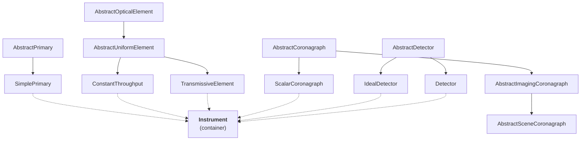

# Architecture

optixstuff is the thin shared hardware dependency for the HWO
simulation suite. This page covers the hardware objects it
provides and the three-axis design (wavelength / position / time).

## The role of optixstuff

`optixstuff` provides **composable hardware objects** -- primary,
throughput elements, coronagraph backend, detector -- and a container
(`Instrument`) that bundles them. The hardware objects hold attributes
like quantum efficiency curves, throughput, dark-current
rates, and pixel scales; downstream tools query those attributes to
do their own work.

It (generally) does **not** simulate. There is no "simulate this observation"
entry point in optixstuff. Instead:

1. **Scalar ETC calculations** (jaxEDITH) ask "given this hardware and
   this target, what's the per-aperture count rate?" The hardware
   attributes are inputs.
2. **2D image simulation** (coronagraphoto) asks "given this hardware
   and this scene, what does the detector see?" The same hardware
   attributes are inputs.

Both tools need the same hardware definition. optixstuff is the shared
source of truth: change the detector's QE here and both your ETC
numbers and your simulated images update together on the next import.

## The abstractions



Five families of abstract base + concrete implementations, composed
into a single `Instrument`:

| Family | Abstract base | Concrete examples |
|---|---|---|
| Primary aperture | `AbstractPrimary` | `SimplePrimary` |
| Throughput-affecting element | `AbstractOpticalElement` | `ConstantThroughput`, `TransmissiveElement` |
| Coronagraph backend | `AbstractCoronagraph` | `ScalarCoronagraph`, `MultiBandCoronagraph` |
| Detector | `AbstractDetector` | `IdealDetector`, `Detector` |
| Composition container | (none) | `Instrument` |

## What throughput elements stand in for

`ConstantThroughput` and `TransmissiveElement` represent optical losses.
Tabulated responses use `optixstuff.spectral.Transmission`,
which interpolates linearly and is zero outside its table. `Transmission.from_band`
represents a unit bandpass; constant optical losses use a scalar
`ConstantThroughput`. Mapping to real hardware:

| Concrete element | Represents |
|---|---|
| `ConstantThroughput` | Flat-reflectivity mirror coating, broadband neutral-density filter, fold mirror with achromatic reflectivity |
| `TransmissiveElement` | An element holding a `Transmission` -- mirror reflectivity curves, bandpass filters, dichroics, other filters |

A real instrument has many individual physical components -- primary
mirror, secondary, deformable mirror, fold mirrors, polarisers,
bandpass filters, dichroics, lenses -- each with its own throughput
curve. In optixstuff they all enter the radiometric model the same
way: "a wavelength-dependent fraction that scales the incoming flux."
The `Instrument` holds a `tuple[AbstractOpticalElement, ...]` whose
effective throughput is the product of every element's
`get_throughput(wavelength_nm)`:

This example requires measured throughput curves and a configured coronagraph and detector.

```python notest
from optixstuff.spectral import Transmission

path = Instrument(
    primary=SimplePrimary(circumscribed_diameter_m=6.0, collecting_area_m2=28.0),
    attenuating_elements=(
        ConstantThroughput(throughput=0.95),  # primary coating
        ConstantThroughput(throughput=0.95),  # secondary mirror
        ConstantThroughput(throughput=0.97),  # fold mirror
        TransmissiveElement(
            Transmission(wavelengths_nm, mirror_R)
        ),  # measured mirror reflectivity
        TransmissiveElement(Transmission(wavelengths_nm, filter_T)),  # bandpass filter
    ),
    coronagraph=...,
    detector=...,
)

print(path.system_throughput(550.0))  # product across all elements
```

The abstraction lets you swap real-instrument throughput curves in
and out without changing how downstream tools consume the result.
Higher-fidelity elements (e.g. one with a position-varying vignetting
profile) can subclass `AbstractOpticalElement` directly to use the
position axis -- see the next section.

## The three-axis design

Optical elements and coronagraphs expose wavelength, position, and time
where those axes affect their response. Detectors expose
`quantum_efficiency(wavelength_nm)` for spectral yield. All detector
subclasses share the same `electrons`, `mean_and_variance`, and `draw`
contract. `IdealDetector` supplies QE one; `Detector` supplies constant
or measured spectral QE. Frame duration belongs to `FramePlan`.

## Instrument as a composable container

`Instrument` is an `eqx.Module` (PyTree-registered) that holds the
hardware configuration:

```python
import equinox as eqx
from optixstuff import (
    AbstractPrimary,
    AbstractOpticalElement,
    AbstractCoronagraph,
    AbstractDetector,
)


class Instrument(eqx.Module):
    primary: AbstractPrimary
    attenuating_elements: tuple[AbstractOpticalElement, ...]
    coronagraph: AbstractCoronagraph
    detector: AbstractDetector
```

The path exposes three quantities used by the readers.

- `system_throughput(wavelength_nm)` -- product of all element
  throughputs at a wavelength
- `detector.quantum_efficiency(wavelength_nm)` -- detector QE at that wavelength
- `spectral_breaks_nm()` -- union of the element, coronagraph, detector, disperser
  and speckle breaks for host quadrature construction

That's it. The container does not own simulation logic; it just holds
hardware. Simulators (coronagraphoto, jaxEDITH) consume the container,
query its throughput / QE / coronagraph response, and produce
science-level outputs.

## Photon rates, electrons, and detector noise

Scene readers supply `PhotonRates` at `optixstuff.spectral.Quadrature` nodes.
`detector.electrons(rates)` applies survival and QE at each
node, then integrates into `ElectronRates`. This is the only detector
yield conversion. Optical throughput remains upstream of that boundary.

The observer chooses a frame duration and calls
`frames_for_time(time_s, frame_time_s)` to obtain a `FramePlan`.
`detector.mean_and_variance(electrons, plan)` computes the electron budget;
`detector.draw(key, electrons, plan)` samples that budget with per-pixel
Poisson counts, optional excess gain noise, and Gaussian read noise.
Combine sources before drawing so detector noise is counted once.

See [detector models](detector_models) for units, shapes, timing, and the
explicit excess-noise distribution.

## Aperture frames, images, and performance records

A primary stores collecting area independently of its two diameter conventions.
`primary.frame(reference_wavelength_nm, convention="circumscribed")` creates a
shared `Frame` without asking the consumer to repeat a diameter conversion.
For segmented apertures the inscribed circle follows the scalloped outer outline,
bridging perimeter gaps; the internal segment gaps reduce collecting area only
through the declared segment sizes, and do not define the aperture diameter.

Select a band with `band(wavelength_nm)`. An imaging band's
`at_wavelength(wavelength_nm)` returns its `source_grid`, `stellar_grid` and
`sky_grid`. Source offsets and stellar diameters use their respective native
frames. The target grid defines the output units, frame and pixel centres.

`source_psfs` returns an image and a validity flag for each source.
`stellar_map` returns the finite-star image. `point_energy_fraction(x_lod, y_lod)`
sums admitted native point-source flux, while `uniform_sky_map` describes
extended illumination. Its annular mean is `uniform_sky_response`.
A scene-capable band provides `render_scene(scene, wavelength_nm, grid=target)`.
The result includes a validity flag covering every illuminated position.

| Product | Image measure | Image quantity |
|---|---|---|
| PSFs and stellar maps on a requested grid | `Measure.integral()` | `stellar_flux_fraction` |
| Uniform-sky map | `Measure.intensive()` | `transmission` |
| Extended scene | `Measure.integral()` | Input scene quantity |

Transmission is dimensionless. A native PSF table retains the sampling declared
by its producer. A requested grid receives the fraction of unocculted source
flux collected by each pixel.

`curves(rule=Circular(0.7), *, leakage_rule="aperture_mean")` selects a prepared
`PerformanceCurves` record. The five scalar convenience methods call its `evaluate` method.
`leakage_density_lod2` is already per square lambda/D; no pixel-area correction
belongs in consumers. Post-processing may divide that density, or raw contrast,
by `ppf`; `jaxedith.PostProcessing.speckle_residual_fraction` owns the residual.
No noise floor is a coronagraph property.
`separation_map`, `throughput_map`, and `core_area_map` are shared contract
projections on each imaging band's native source grid.
For table images, `stellar_map(..., grid=None)` and `source_psfs(..., grid=None)`
return native samples and product metadata. An explicit grid requests pixel
integration, including at native pitch.
The record's contrast identity holds at measured knots; `PerformanceCurves` interpolates the
five fields in their declared spaces independently between knots.
Additional rules and leakage conventions must be prepared during construction.
Finite stellar diameter remains an image capability; scalar records retain the
diameter of the stellar image used to prepare them. `band(wavelength_nm).curves()`
selects a multiband record; `curves()` alone uses the reference band.
`bandpass` is a `optixstuff.spectral.Band` or `None` for unknown coverage;
each child of a multiband model must declare its interval. The first child
covering the requested wavelength supplies the record, including at a shared
edge. A wavelength outside all calibrated intervals raises `ValueError`.

## Speckle excess

`AbstractSpeckleField` owns a native `lod` `grid` with its `Frame` and an
`epoch_d` clock origin. It remains the interface for nonlinear implementations,
including replayed intensity cubes. `LinearSpeckleField` supplies the common
law for coefficient-driven fields; subclasses implement `coefficients(time_d)`
and subtract `epoch_d` internally. Wavelengths are nm, absolute times are days
from the scene epoch, and exposure durations are seconds.

A `FocalResponse` stores the linear family's nominal amplitude density
`e_nom` and sensitivity density `G` with shapes `(ny, nx)` and
`(n_modes, ny, nx)`, as well as the grid and unocculted input energy.
`response.per_pixel()` supplies the amplitudes for the stable excess law
`[2 Re(conj(e_nom) G eps) + |G eps|^2] / input_energy`. The shared law scales
`G` by `reference_wavelength_nm / wavelength_nm`.

`realize(wavelength_nm=..., time_d=...)` returns an `Image` on `self.grid`,
with `Measure.integral()`, `stellar_flux_fraction`, `band_limited`, and `reflect`
metadata. Wavelength and time arrays form an outer product; wavelength axes
lead time axes, followed by `(y, x)`. A `(W, Q)` wavelength array has axes
`("band", "quadrature")`. Native coordinates describe lambda/D at each node:
its angular basis is `grid.basis * grid.frame.lod_to_arcsec(node_nm)`.
Convert each node grid with `grid.to_arcsec(node_nm)` before resampling to a
fixed detector. The same Frame conversion applies to native coronagraph
products, whose stored reference grid remains explicit.

`broadened(quadrature=..., time_d=...)` integrates all realized nodes at fixed
native lambda/D coordinates, dividing the nm weights by their per-band sum.
The output retains flux-fraction units and the band axis. It cannot replace
node-level resampling and spectral weighting for a fixed angular detector.
`realize_average(..., start_time_d=..., exposure_s=..., n_sub=8)` averages
realized Images with the midpoint rule, retaining metadata.

`epoch_d` is a static host float64 origin. Enable JAX x64 and promote absolute
timestamps before adding small offsets on device; subtracting the epoch cannot
recover precision lost in a float32 absolute time. Deep-contrast calculations
also require float64/complex128 arrays.
