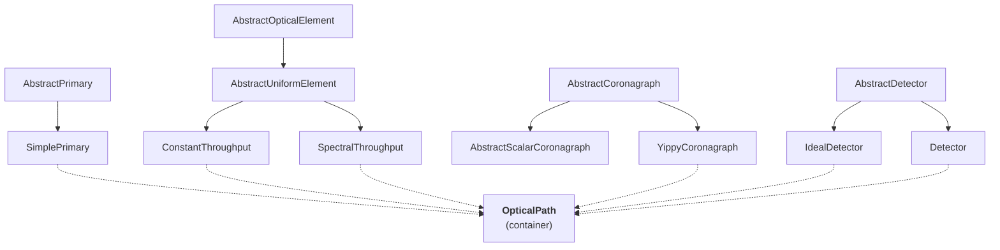

# Architecture

optixstuff is the thin shared hardware dependency for the HWO
simulation suite. This page covers the hardware objects it
provides and the three-axis design (wavelength / position / time).

## The role of optixstuff

`optixstuff` provides **composable hardware objects** -- primary,
throughput elements, coronagraph backend, detector -- and a container
(`OpticalPath`) that bundles them. The hardware objects hold attributes
like quantum efficiency curves, throughput, dark-current
rates, and pixel scales; downstream tools query those attributes to
do their own work.

It (generally) does **not** simulate. There is no "simulate this observation"
entry point in optixstuff. Instead:

1. **Scalar ETC calculations** (jaxEDITH) ask "given this hardware and
   this target, what's the per-aperture count rate?" The hardware
   attributes are inputs.
2. **2D image simulation** (coronagraphoto) asks "given this hardware
   and this scene, what does the detector see?" The same hardware
   attributes are inputs.

Both tools need the same hardware definition. optixstuff is the shared
source of truth: change the detector's QE here and both your ETC
numbers and your simulated images update together on the next import.

## The abstractions



Five families of abstract base + concrete implementations, composed
into a single `OpticalPath`:

| Family | Abstract base | Concrete examples |
|---|---|---|
| Primary aperture | `AbstractPrimary` | `SimplePrimary` |
| Throughput-affecting element | `AbstractOpticalElement` | `ConstantThroughput`, `SpectralThroughput` |
| Coronagraph backend | `AbstractCoronagraph` | `YippyCoronagraph` |
| Detector | `AbstractDetector` | `IdealDetector`, `Detector` |
| Composition container | (none) | `OpticalPath` |

## What throughput elements stand in for

`ConstantThroughput` and `SpectralThroughput` are abstract enough to
represent any wavelength-dependent loss in the optical path. Mapping
to real hardware:

| Concrete element | Represents |
|---|---|
| `ConstantThroughput` | Flat-reflectivity mirror coating, broadband neutral-density filter, fold mirror with achromatic reflectivity |
| `SpectralThroughput` | Any tabulated wavelength-dependent throughput -- mirror reflectivity curves, bandpass filters, dichroics, other filters |

A real instrument has many individual physical components -- primary
mirror, secondary, deformable mirror, fold mirrors, polarisers,
bandpass filters, dichroics, lenses -- each with its own throughput
curve. In optixstuff they all enter the radiometric model the same
way: "a wavelength-dependent fraction that scales the incoming flux."
The `OpticalPath` holds a `tuple[AbstractOpticalElement, ...]` whose
effective throughput is the product of every element's
`get_throughput(wavelength_nm)`:

This example requires measured throughput curves and a configured coronagraph and detector.

```python notest
path = OpticalPath(
    primary=SimplePrimary(diameter_m=6.0),
    attenuating_elements=(
        ConstantThroughput(throughput=0.95),  # primary coating
        ConstantThroughput(throughput=0.95),  # secondary mirror
        ConstantThroughput(throughput=0.97),  # fold mirror
        SpectralThroughput(wavelengths_nm, mirror_R),  # measured mirror reflectivity
        SpectralThroughput(wavelengths_nm, filter_T),  # bandpass filter
    ),
    coronagraph=...,
    detector=...,
)

print(path.system_throughput(550.0))  # product across all elements
```

The abstraction lets you swap real-instrument throughput curves in
and out without changing how downstream tools consume the result.
Higher-fidelity elements (e.g. one with a position-varying vignetting
profile) can subclass `AbstractOpticalElement` directly to use the
position axis -- see the next section.

## The three-axis design

Optical elements and coronagraphs expose wavelength, position, and time
where those axes affect their response. Detectors expose
`quantum_efficiency(wavelength_nm)` for spectral yield. All detector
subclasses share the same `electrons`, `mean_and_variance`, and `draw`
contract. `IdealDetector` supplies QE one; `Detector` supplies constant
or measured spectral QE. Frame duration belongs to `FramePlan`.

## OpticalPath as a composable container

`OpticalPath` is an `eqx.Module` (PyTree-registered) that holds the
hardware configuration:

```python
import equinox as eqx
from optixstuff import (
    AbstractPrimary,
    AbstractOpticalElement,
    AbstractCoronagraph,
    AbstractDetector,
)


class OpticalPath(eqx.Module):
    primary: AbstractPrimary
    attenuating_elements: tuple[AbstractOpticalElement, ...]
    coronagraph: AbstractCoronagraph
    detector: AbstractDetector
```

Two convenience methods compose elements:

- `system_throughput(wavelength_nm)` -- product of all element
  throughputs at a wavelength
- `detector.quantum_efficiency(wavelength_nm)` -- detector QE at that wavelength

That's it. The container does not own simulation logic; it just holds
hardware. Simulators (coronagraphoto, jaxEDITH) consume the container,
query its throughput / QE / coronagraph response, and produce
science-level outputs.

## Photon rates, electrons, and detector noise

Scene readers supply `PhotonRates` at `hwoutils.spectral.Quadrature` nodes.
`detector.electrons(rates, quadrature)` applies survival and QE at each
node, then integrates into `ElectronRates`. This is the only detector
yield conversion. Optical throughput remains upstream of that boundary.

The observer chooses a frame duration and calls
`frames_for_time(time_s, frame_time_s)` to obtain a `FramePlan`.
`detector.mean_and_variance(electrons, plan)` computes the electron budget;
`detector.draw(key, electrons, plan)` samples that budget with per-pixel
Poisson counts, optional excess gain noise, and Gaussian read noise.
Combine sources before drawing so detector noise is counted once.

See [detector models](detector_models) for units, shapes, timing, and the
explicit excess-noise distribution.
