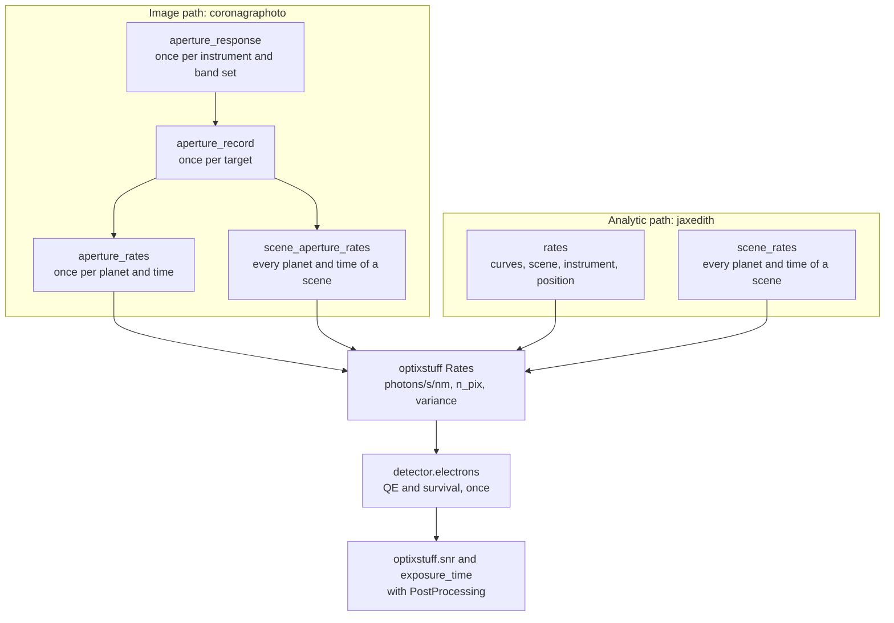

# How an exposure time is computed

Two libraries in the suite answer "how long until this planet reaches a signal-to-noise ratio of 7", and they start from different places. coronagraphoto renders the scene on the detector and sums the images in an aperture. jaxedith multiplies a few scalars from performance curves. Both stop at the same object, an optixstuff `Rates` record for one aperture, and one pair of functions turns that record into a time. This page follows the two roads to that record and then the last step.

## Two roads end in one record

A `Rates` record holds six named source rates for one aperture, here in photons per second per nanometre at the nodes of a wavelength quadrature: `planet`, `star_leakage`, `local_zodi`, `exozodi`, `thermal` and `stellar_companions`. It also holds the aperture's pixel count `n_pix` and a second record, `variance`, summed with the squared aperture weights.

The `thermal` field is the warm telescope's own emission. An `Instrument` built with a `WarmEmission` (the telescope temperature and an effective emissivity, warm emissivity times cold transmission) gives it through `SelectedInstrument.thermal_photon_rate_per_sr`, the Planck photon radiance times the emissivity times the collecting area, in photons per second per nanometre per steradian; a producer multiplies by the aperture solid angle. The default `warm_emission=None` is no emission. `jaxedith.rates` fills `thermal` this way. `coronagraphoto` renders it as a uniform image and records it per pixel for its aperture reads, so both producers fill the field.



The image path pays once to learn what the coronagraph does to a point source and to the backgrounds. `coronagraphoto.aperture_response` places point sources on rings and records the planet throughput against separation. `coronagraphoto.aperture_record` renders the star leakage, a uniform sky and the disk once and sums each in the aperture at every half-pixel position. `coronagraphoto.aperture_rates` reads one planet from those tables, and `coronagraphoto.scene_aperture_rates` reads every planet of a scene at every time. The aperture sums come from the same images the simulator draws, so the record agrees with an aperture sum of `coronagraphoto.expected`.

The analytic path skips the images. `jaxedith.rates` takes a `PerformanceCurves` record, the scene, the instrument and a planet position, reads the curves at the planet's separation in lambda/D, and multiplies each source by the collecting area, the system throughput and the aperture. It is the scalar arithmetic of AYO and pyEDITH, evaluated per spectral node, and it returns the same `Rates` type. `jaxedith.scene_rates` is its counterpart of `coronagraphoto.scene_aperture_rates`: every planet of a scene at every time, with the same `(W, Q, K, T)` layout.

Because the two records are the same type, everything after them is shared. Neither producer applies detector yield: the record is photons, and `detector.electrons(rates)` applies quantum efficiency and survival once, at the nodes, before integrating each band. The two roads can differ in their rates, since one measures the coronagraph on images and the other reads summary curves, but they cannot differ in how a rate becomes a time.

## One aperture, one budget

Start with one aperture that already holds electrons per second, so no producer is involved. The planet delivers 0.05 electrons per second. The star leakage, local zodi and exozodi add 0.20, 0.02 and 0.03, spread over 12 pixels, and the detector adds dark current and clock-induced charge.

The count variance after `t` live seconds is the sum of the planet's shot noise, every background's variance, and a residual that does not average down. With planet electrons per second `p`, the detector variance of one frame divided by its live seconds `b`, and the squared residual rate `f2`, it is `b t + f2 t**2`. This gives

- `S/N = p t / sqrt(b t + f2 t**2)`
- `t = snr**2 b / (p**2 - snr**2 f2)`

The detector supplies `b` through `detector.mean_and_variance`, the same call that sizes a drawn image, so an exposure time and a simulated observation share one statistical model. The `f2` term is the reason some targets are unreachable: once `p` falls to `snr * sqrt(f2)` no time is long enough, and the result has `valid` False and a time of NaN.

## What PostProcessing states

`optixstuff.PostProcessing` holds the assumptions of the subtraction that follows the observation. It has three numbers, and the third has no default.

`speckle_residual_fraction` and `exozodi_residual_fraction` lie in [0, 1]. They are the fractions of the mean star-leakage and exozodi rates that survive subtraction, so `f2` is the sum of their squared products with the rates. AYO and pyEDITH write the speckle fraction as `1 / ppf`, the inverse of the post-processing factor.

`background_variance_factor` is `m >= 1`. It multiplies the variance of every source except the planet's own shot noise: star leakage, zodi, exozodi, thermal, companions, dark current, clock-induced charge and read noise. Two is differential imaging, where a reference image with the same background variance is subtracted from the science image, so each background is counted twice. This is the convention of Stark et al. 2014, AYO and pyEDITH. One means no reference subtraction. The caller must state it, because no subtraction is a different assumption from perfect subtraction.

Before running the next block, guess how much longer the planet takes to reach S/N 7 when `m` is 2 instead of 1.

```python
import optixstuff as ox
from optixstuff import Detector, PostProcessing, Rates
from optixstuff.spectral import Band

bands = (Band(500.0, 600.0),)
electrons = Rates(
    bands,
    "electron",
    planet=0.05,
    star_leakage=0.20,
    local_zodi=0.02,
    exozodi=0.03,
    n_pix=12.0,
)
detector = Detector(
    pixel_scale_arcsec=0.01,
    shape=(1, 1),
    qe=0.9,
    dark_current_e_per_pixel_s=3e-5,
    clock_induced_charge_e_per_pixel_frame=1e-3,
    read_noise_e_rms=0.0,
)

for factor in (1.0, 2.0):
    post_processing = PostProcessing(0.02, 0.02, background_variance_factor=factor)
    result = ox.exposure_time(
        electrons,
        detector,
        7.0,
        frame_time_s=100.0,
        post_processing=post_processing,
    )
    print(factor, result.time_s, result.valid)
```

The time grows from about 8700 s to about 15900 s, a factor of 1.8 rather than 2, because the planet's own shot noise is counted once in both. The estimate beside it: when the backgrounds dominate the variance, the time scales with `m`, and here the planet contributes about a sixth of the variance at `m = 1`, so the factor falls a little short of 2.

The time is continuous. Round it up to whole frames with `optixstuff.frames_for_time(time_s, frame_time_s)`, and compute the S/N at that time with `optixstuff.snr`, which uses the same statistics and returns 7 at the time `exposure_time` gave.

## Which factor a published code uses

The factor is the one place the community codes differ in the arithmetic after the rates. AYO and pyEDITH use `m = 2` with `1 / ppf` as the speckle fraction. EXOSIMS characterization uses `m = 1`, and its detection mode leaves the planet's shot noise out of the variance, which no setting of `PostProcessing` reproduces.

The jaxedith validation tests use the first convention. `tests/validation/test_pyedith.py` compares `jaxedith.rates` and `optixstuff.exposure_time` against a stored pyEDITH run, whose own multiplier is 2, and the science time agrees at float64 rounding. `tests/validation/test_ayo.py` compares the rates against the AYO calibration workbook, and its reference cases use `m = 2` for the time.

## Where to go next

- coronagraphoto: [aperture rates and exposure time](https://coronagraphoto.readthedocs.io/en/latest/explanation/exposure_time.html) covers the three tables, the local zodi and the roll.
- jaxedith: [conventions](https://jaxedith.readthedocs.io/en/latest/explanation/conventions.html) lists each term and the settings of each community code.
- [Detector models](detector_models) covers the statistics behind `b`.
