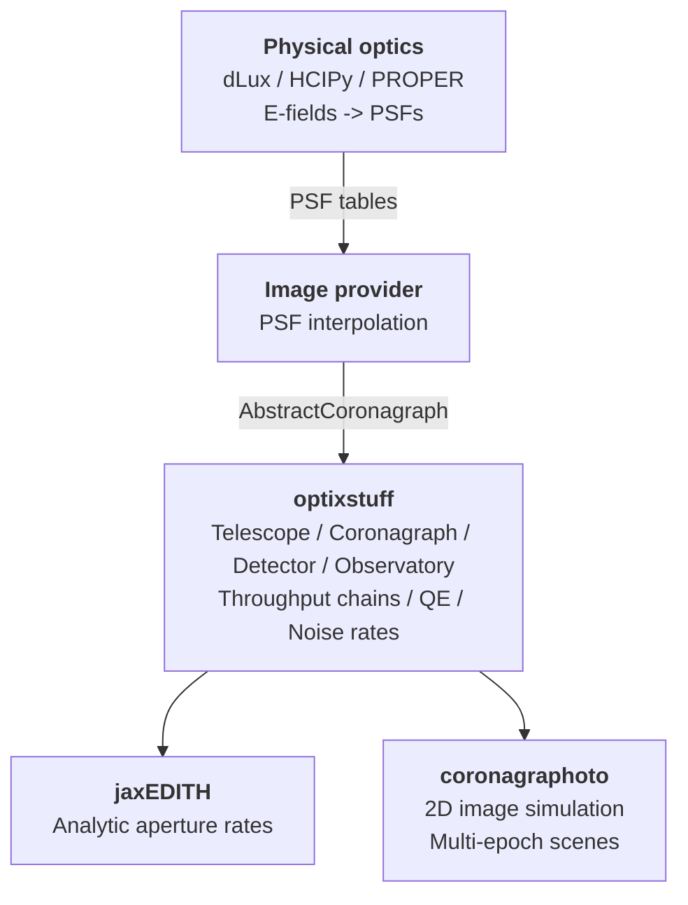

# optixstuff

Shared hardware objects, with standard values, for the HWO
direct-imaging simulation suite.

`optixstuff` is a **thin shared dependency** that defines the
observatory's hardware as composable JAX modules: pupil,
throughput-affecting elements, coronagraph backend, detector. It does
not simulate, retrieve, or analyze anything in its own right; its job
is to be the single source of truth for the hardware configuration
that downstream tools consume.

Both {mod}`coronagraphoto` (2D image simulation) and
[jaxEDITH](https://github.com/CoreySpohn/jaxedith) (analytic aperture
rates) import the same {class}`~optixstuff.Observatory` class and the
same detector / throughput / pupil types from optixstuff; jaxEDITH
reads coronagraph performance as {class}`~optixstuff.PerformanceCurves`
data. Change a value here and both downstream tools pick it up on the
next import. Both end at an {class}`~optixstuff.Rates` record, which
{func}`optixstuff.snr` and {func}`optixstuff.exposure_time` reduce to
S/N or exposure time; [how an exposure time is computed](explanation/exposure_time.md)
follows both roads.

## What optixstuff is NOT

- **Not a wavefront tool.** Diffraction and E-field propagation belong
  to [dLux](https://github.com/LouisDesdoigts/dLux) and
  [HCIPy](https://github.com/ehpor/hcipy).
- **Not a PSF interpolator.** Image providers implement
  {class}`~optixstuff.AbstractCoronagraph`; optixstuff owns the contract
  and scalar performance models.
- **Not a scene model.** Stars, planets, disks, and zodi live in
  {mod}`skyscapes`.
- **Not a simulator.** Downstream tools ({mod}`coronagraphoto`,
  [jaxEDITH](https://github.com/CoreySpohn/jaxedith)) consume an
  {class}`~optixstuff.SelectedInstrument` (from
  {meth}`~optixstuff.Observatory.select`) to produce images / count rates.

## Ecosystem position



## Quick start

This example builds an observatory around a coronagraph. The coronagraph
comes from a provider such as a yippy `Coronagraph`; its lambda/D frame must
describe the same telescope as the pupil.

```python notest
from optixstuff import (
    Instrument,
    Observatory,
    SimplePupil,
    Telescope,
    IdealDetector,
    ConstantThroughput,
)

pupil = SimplePupil(circumscribed_diameter_m=6.0, collecting_area_m2=28.0)
detector = IdealDetector(pixel_scale_arcsec=0.01, shape=(512, 512))
throughput = ConstantThroughput(throughput=0.85)

observatory = Observatory(
    Telescope(pupil),
    (
        Instrument(
            "imager",
            attenuating_elements=(throughput,),
            coronagraph=coronagraph,  # any AbstractCoronagraph
            detector=detector,
        ),
    ),
)
selected = observatory.select("imager")

# Throughput at a wavelength
print(selected.system_throughput(550.0))  # scalar throughput
print(selected.detector.quantum_efficiency(550.0))  # QE at 550 nm
```

## Installation

```bash
pip install optixstuff
```

## Architecture

Built on [JAX](https://github.com/google/jax) and
[Equinox](https://github.com/patrick-kidger/equinox), optixstuff
provides:

- **Abstract interfaces**: `AbstractPupil`,
  `AbstractOpticalElement`, `AbstractCoronagraph`, `AbstractDetector`
- **Concrete implementations**: `SimplePupil`, `ConstantThroughput`,
  `TransmissiveElement`, `IdealDetector`, `Detector`, `MultiBandCoronagraph`
- **Containers**: `Telescope` (the pupil and the shared throughput),
  `Instrument` (one named configuration, with an optional `WarmEmission`
  for the warm telescope's thermal emission) and `Observatory`, whose
  `select(name)` returns the `SelectedInstrument` view passed to all
  downstream simulators

Optical elements and coronagraphs accept fidelity axes (**wavelength**,
**position**, and **time**) with defaults so simple implementations
can ignore unused axes while future high-fidelity models
(wavelength-dependent coatings, position-dependent vignetting,
time-dependent detector degradation) can use them without breaking
the interface.

See [architecture](explanation/architecture) for the full abstraction
hierarchy, and [detector models](explanation/detector_models) for an
overview of photon rates, electron statistics, and detector draws, and
[how an exposure time is computed](explanation/exposure_time.md) for the path from
a `Rates` record to S/N and time.

```{toctree}
:maxdepth: 1
:caption: Explanation
:hidden:

explanation/architecture
explanation/exposure_time
explanation/detector_models
explanation/grids_and_spectra
```

<!-- TODO(post-1.0): write tutorials/01_building_an_optical_path and re-add a "Get started" toctree. -->


```{toctree}
:maxdepth: 2
:caption: API Reference
:hidden:

autoapi/index
```
